# NanoNino Attendance — Face Recognition Kiosk

A desktop kiosk where employees check in and out by looking at a camera.
**FastAPI** backend + **Flutter (Windows)** frontend, with face recognition
(YuNet + SFace, ONNX via OpenCV), a server-enforced blink liveness check (MediaPipe Face Landmarker), a **face
anti-spoofing CNN served with ONNX Runtime** ([ml/antispoof](ml/antispoof/README.md))
an admin dashboard (desktop and **web**) and a personal dashboard for every employee.


| Lock screen (tap anywhere to check in) | Camera check-in |
|---|---|
| 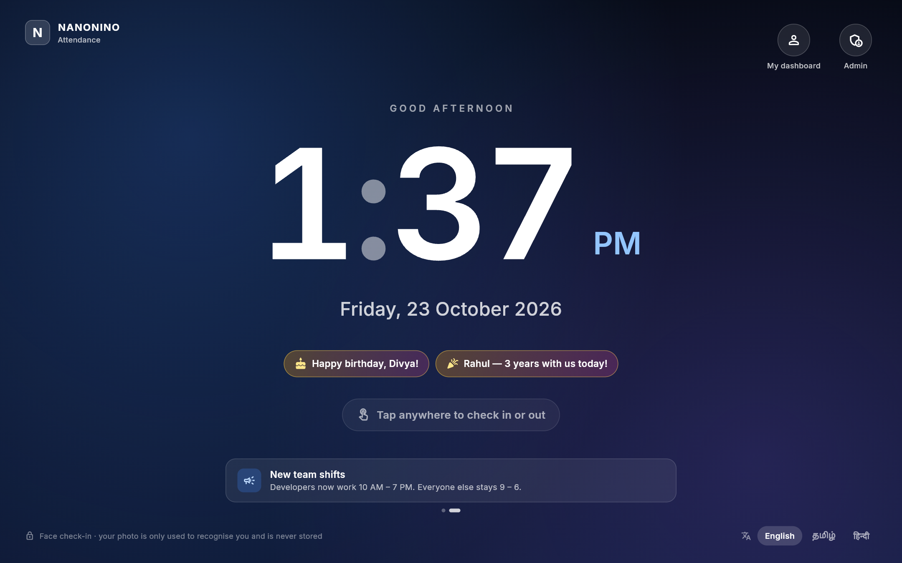 | 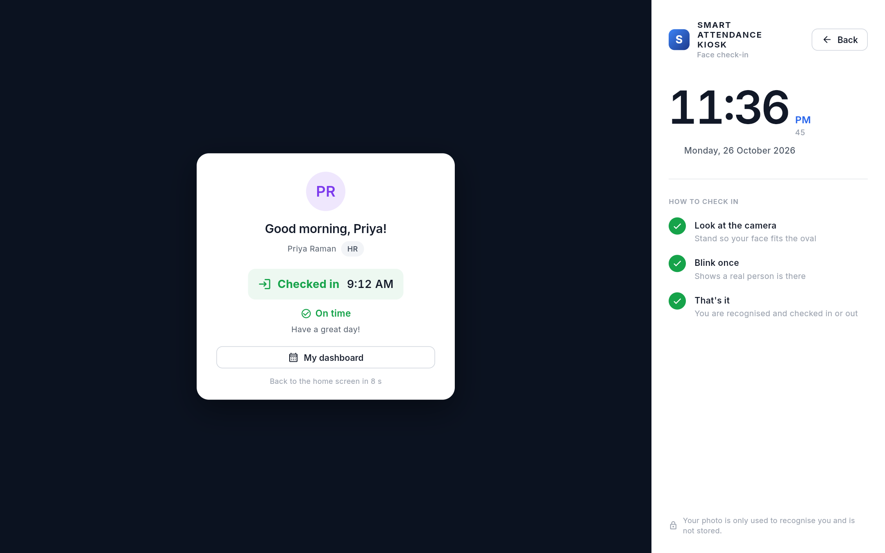 |
| **Admin overview** | **Notice board** (shown on the lock screen) |
| 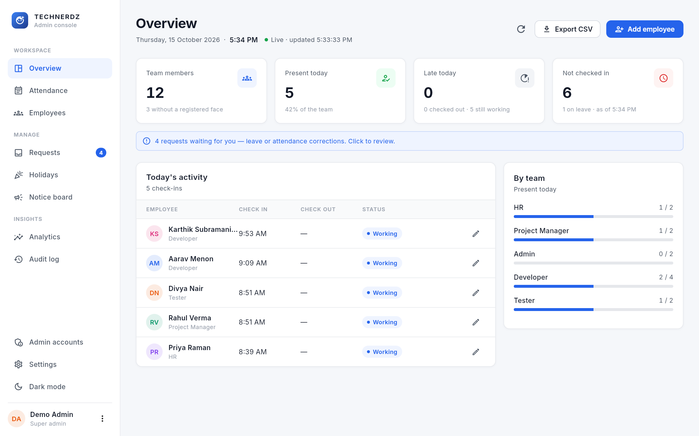 | 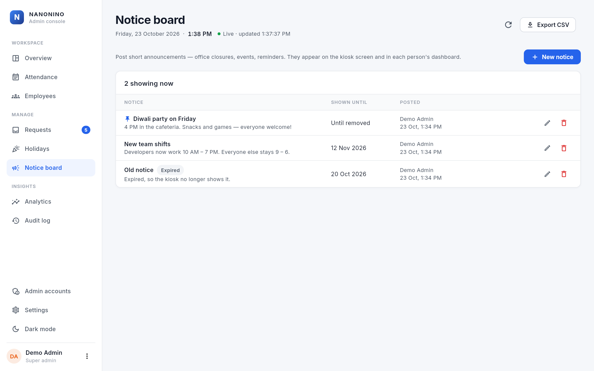 |
| **Monthly register** (exports to Excel) | **Employee profile** |
| 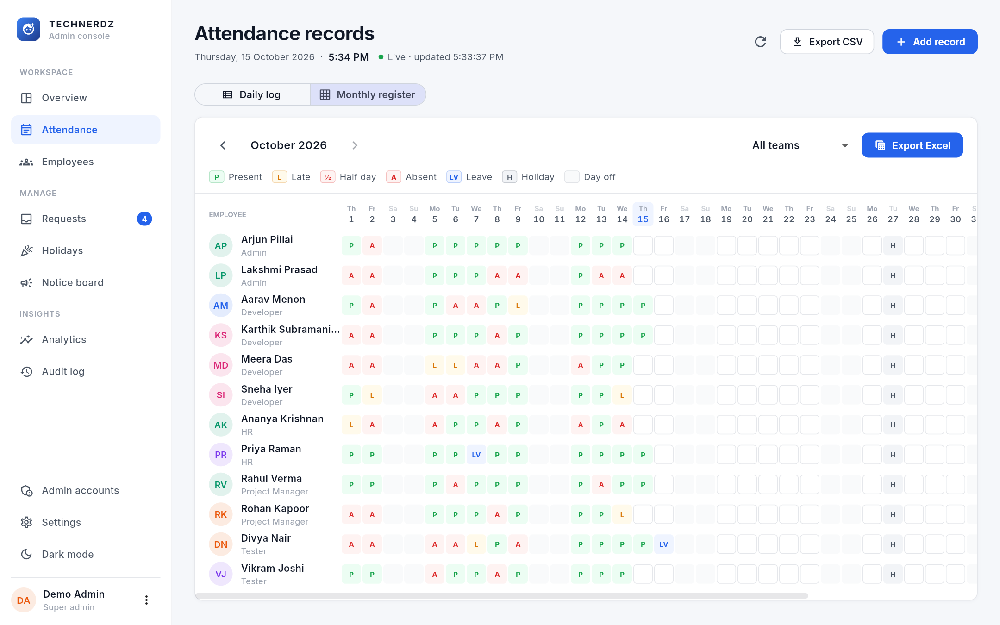 | 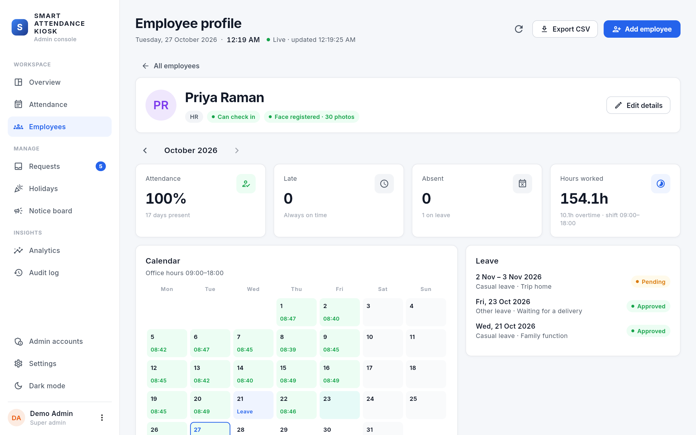 |
| **Analytics** | **Dark mode** |
| 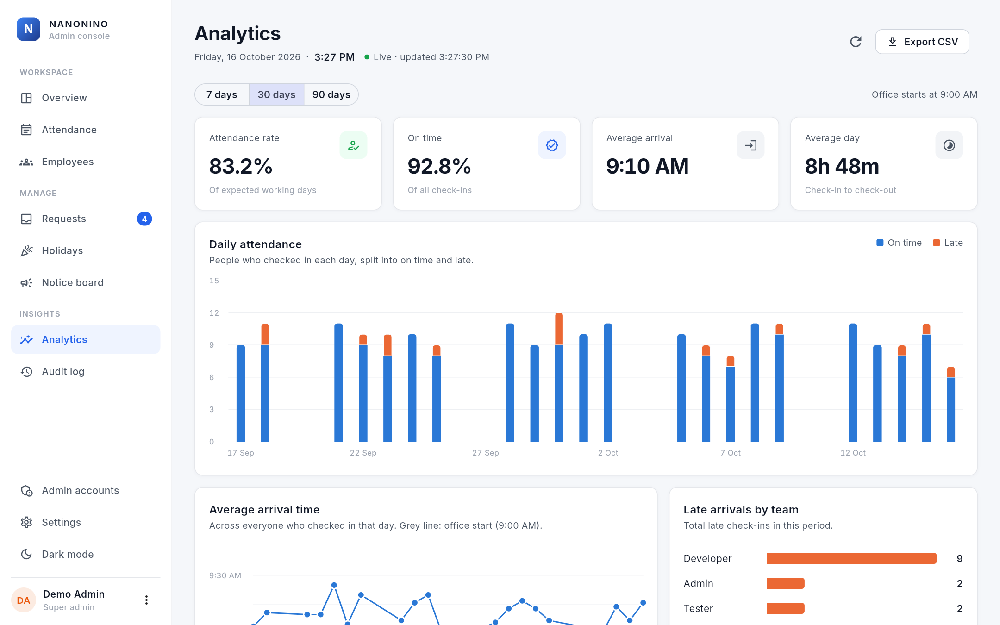 | 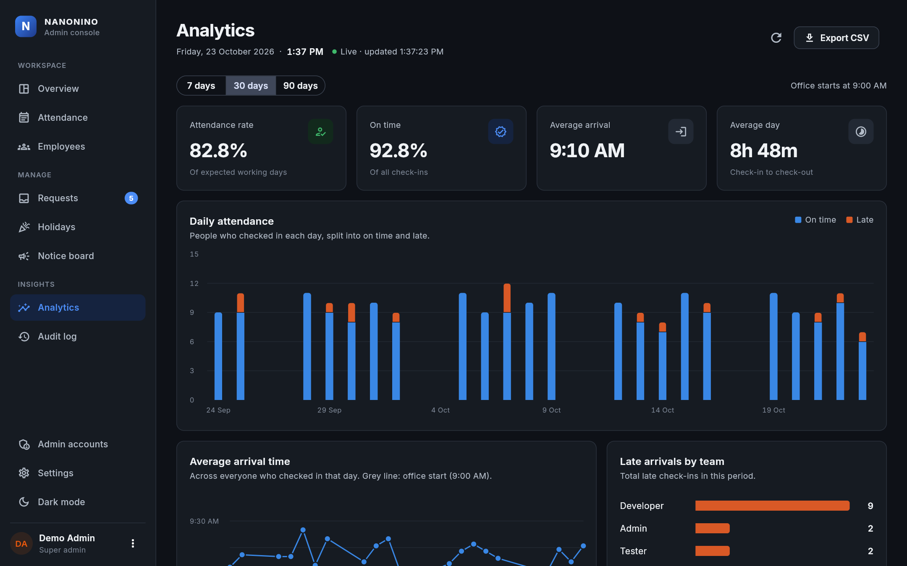 |
| **Requests** | **Admin accounts** (super admin / read-only HR viewer) |
| 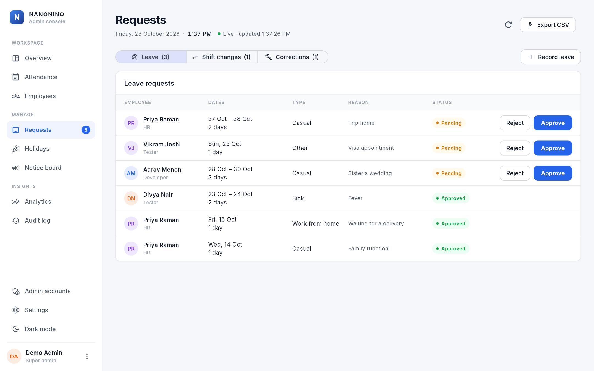 | 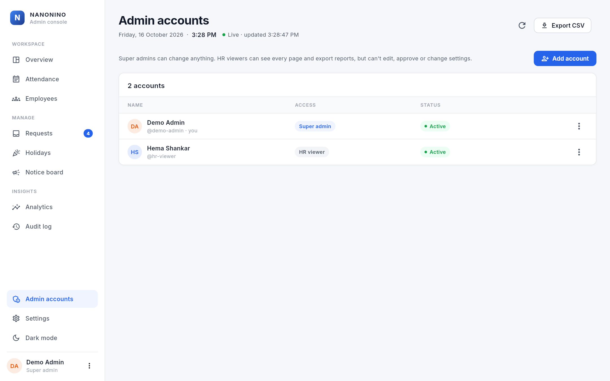 |
| **Settings** with per-team shifts | |
| 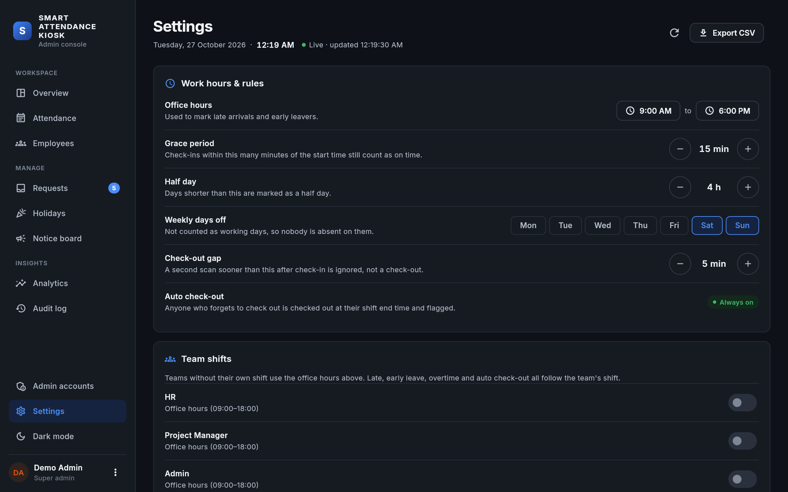 | |

**My dashboard** — each employee's own page, opened at the kiosk by face (no password):

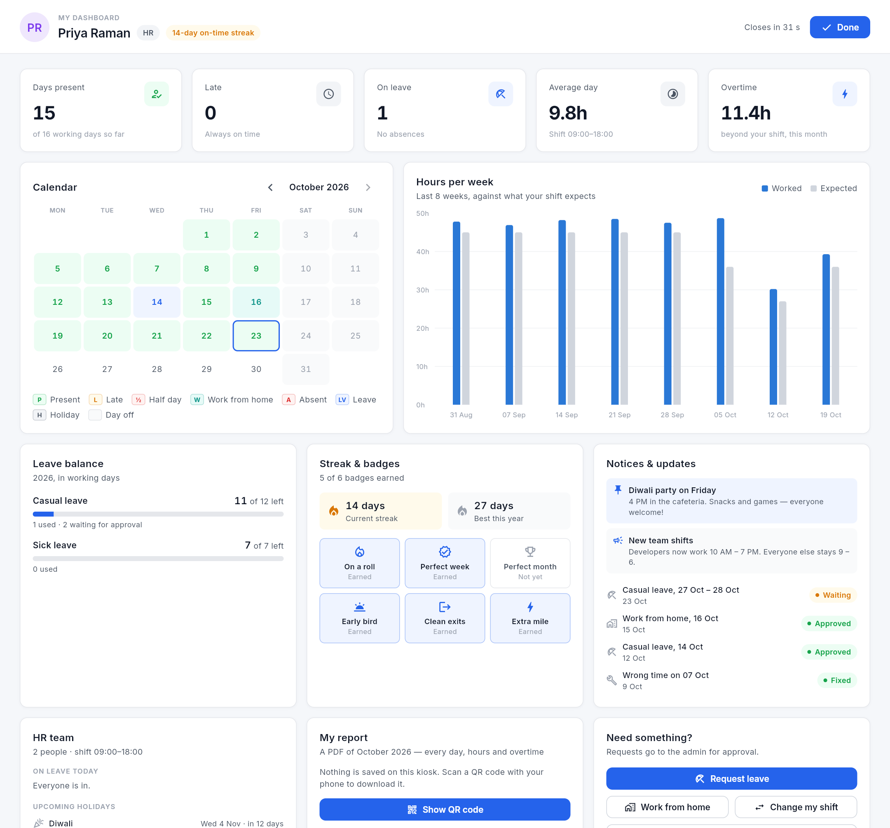

<sub>Screenshots use made-up demo data (`scripts/seed_demo.py`) and are regenerated with
`python scripts/screenshots.py`.</sub>

```
 Flutter kiosk                         FastAPI server
 ┌───────────────┐   password login    ┌──────────────────────────────┐
 │ Lock screen   │ ──────────────────▶ │ /auth   JWT, bcrypt, lockout  │
 │ Face verify   │   camera frames     │ /attendance/liveness          │
 │   (blink)     │ ──────────────────▶ │   EAR blink → 60s one-time    │
 │               │   photo + token     │   liveness token              │
 │               │ ──────────────────▶ │ /attendance/verify            │
 │               │                     │   anti-spoof CNN (ONNX)       │
 │ Admin panel   │                     │   1:1 face match → IN / OUT   │
 └───────────────┘                     │ /admin  (admin role only)     │
                                       └──────────────┬───────────────┘
                                          SQLite / MySQL + face_images/
```

## How a check-in works
When idle the kiosk shows a **lock screen**: a big clock, the date and company notices, with the
camera off. **Tap anywhere** to open the camera; it goes back to the lock screen by itself after the
scan (or 30 s with nobody in front of it). Two icons in the corner open **My dashboard** (by face)
and **Admin sign-in**. The company name comes from Settings, so the kiosk shows whatever you call it.

Employees have **no username or password** — they tap, look at the camera and blink.
1. The kiosk streams frames to `/kiosk/liveness` under a random per-scan session id. The server
   computes the **Eye Aspect Ratio** from 478 face landmarks and waits for open → closed eyes.
2. On a blink it issues a **single-use liveness token** (60 s, bound to that scan session).
3. `/kiosk/check-in` refuses without that token, runs the **anti-spoofing model**
   (live face, or a print / phone / monitor?), then **identifies** the person: their 128-d SFace
   embedding is compared with every active employee's ~30 registered photos. The best match must
   clear the threshold *and* beat the runner-up by a margin, so look-alikes are refused, not guessed.
4. First scan of the day = IN; a scan at least `MIN_CHECKOUT_MINUTES` later = OUT.

Employees belong to a team: **HR, Project Manager, Admin, Developer, Tester**. "Admin" is a job
title; dashboard access comes only from an admin account (small icon on the kiosk → username +
password, any password you like, changeable in the dashboard; signs out after 5 idle minutes).
Admin accounts are either **super admins** (change anything) or **HR viewers** (see and export
everything, change nothing — enforced by the API, not just hidden buttons).

Each team can have its **own shift** (e.g. Developers 10:00–19:00); late, early leave, overtime
and auto check-out all follow it.

## Features
| For employees (kiosk) | For admins (dashboard) |
|---|---|
| Walk up, blink, recognised — no password | Overview: present, late, not in, by team, pending requests |
| "Good morning, Priya! On time" / "Late by 12 min" / "Worked 8h 05m" | Attendance with Late / Left early / Half day / Missed check-out / **Overtime** badges |
| **My dashboard** (person icon → scan, no check-in recorded) | Corrections and added days with a required reason |
| Calendar of the month, hours per week vs expected, overtime | Requests: approve/reject leave, fix reported records |
| **Leave balance** (yearly allowance − approved leave, pending shown) | Holidays calendar (excluded from absences) |
| **On-time streak** and badges (Perfect week, Early bird, Extra mile...) | **Notice board**: posts appear on the kiosk and in every dashboard |
| Notices, replies to my requests, my team's leave today, upcoming holidays | Analytics: daily on-time vs late, arrival trend, late by team, punctuality |
| **Monthly PDF report** via a QR code — downloads on your phone, nothing saved on the kiosk | Audit log of every admin and system action |
| Request leave, report a missed check-out | Monthly register (P/L/A/LV/H grid, overtime) with **Excel export** and per-employee profiles |
| Closes itself after 90 s idle | **Admin accounts** with roles; **web dashboard** for HR's own computers |
| | Settings: office hours, **team shifts**, grace, half day, days off, **leave allowance**, HR email, backups, dark mode |

Automatic jobs: forgotten check-outs are closed at office end time (flagged), HR gets a daily
summary email (Gmail SMTP; saved to `reports/emails/` until SMTP is configured), and the
database is backed up daily (14 copies kept in `backups/`). The dashboard refreshes itself every 30 s.

CI: GitHub Actions runs the backend tests and Flutter analyze/tests on every push.

## Run it

**Quickest (Windows, after setup):** double-click `run.bat`. It starts the servers in minimised
windows (each restarts itself if it crashes), waits until they're ready, then opens the kiosk app
**full screen with no title bar** (`--kiosk`). Super admins close it from their account menu
("Close the kiosk app"). To start it automatically when Windows signs in:
`powershell -ExecutionPolicy Bypass -File scripts\install_autostart.ps1` (`-Remove` undoes it).

**Web dashboard** (for HR on their own computers): run `scripts\build_web.bat` once, restart the
server, then open `http://<kiosk-pc-ip>:8000/app/` in a browser and sign in with an admin account.
It's the same Flutter app compiled for the web, served by the API server itself, so there's no CORS
or separate hosting. Face registration stays on the kiosk PC (it needs the camera).
`run.bat` listens on the office network (`HOST=0.0.0.0`) so browsers and phones can reach it; set
`HOST=127.0.0.1` in it to keep everything on the kiosk PC.

**Backend with Docker** (any OS):
```bash
copy .env.example .env          # then set SECRET_KEY
docker compose up --build       # API on http://localhost:8000, data kept in ./docker-data
docker compose exec api python scripts/create_admin.py --username admin
```

**Backend without Docker** (Python 3.11):
```bash
python -m venv .venv && .venv\Scripts\activate
pip install -r requirements-dev.txt
copy .env.example .env          # then set SECRET_KEY
python scripts/create_admin.py --username admin --name "Admin"
uvicorn main:app --reload       # API docs at http://127.0.0.1:8000/docs
pytest                          # 118 tests, no camera needed
```

**App** (Flutter, Windows desktop):
```bash
cd technerdz_app
flutter pub get
flutter run -d windows                                     # local server
flutter run -d windows --dart-define=API_URL=http://<server-ip>:8000
```

## Security notes
- The kiosk endpoints (check-in, open my dashboard) are gated by liveness + anti-spoofing; admin
  pages need an admin JWT. Only current notices are public. There is no public list of employee names.
- Tokens are typed: admin `access`, single-use `liveness`, 5-minute `self` (my dashboard) and
  10-minute `report` (one person's PDF, for the QR link). Each endpoint accepts only its own type.
- HR viewer accounts are read-only on the server: every write endpoint requires a super admin, and
  the last active super admin can't be demoted or disabled.
- On the office network the server speaks plain HTTP. Put it behind HTTPS (e.g. a reverse proxy)
  before using the web dashboard over Wi-Fi you don't trust.
- Employees have no password at all (`!` placeholder that can never match), so their accounts
  can't be used to sign in.
- Login lockout is per (username, IP) so one machine can't lock someone out everywhere.
- Blink liveness stops printed photos; the anti-spoofing CNN (MiniFASNet, ~7 ms) targets
  phone/screen replays. Its attack-detection rate still needs measuring on real attack
  recordings — see [ml/antispoof/README.md](ml/antispoof/README.md).

## Privacy
`face_images/`, the database and `.env` are git-ignored — they contain biometric data and secrets.

## Benchmarks
Face verification on LFW (6,000 pairs, standard 10-fold protocol), `python ml/face_benchmark.py`:
see [reports/face_benchmark.json](reports/face_benchmark.json) and the table in
[ml/README.md](ml/README.md).
